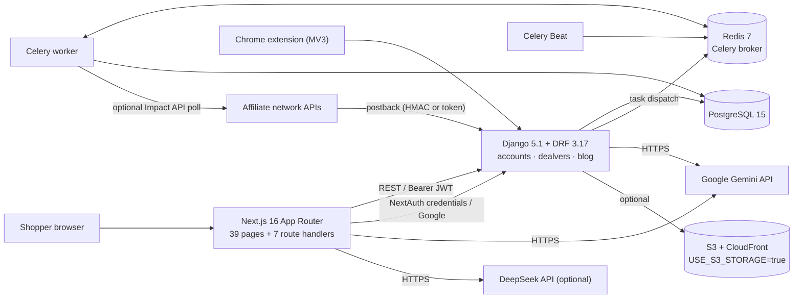
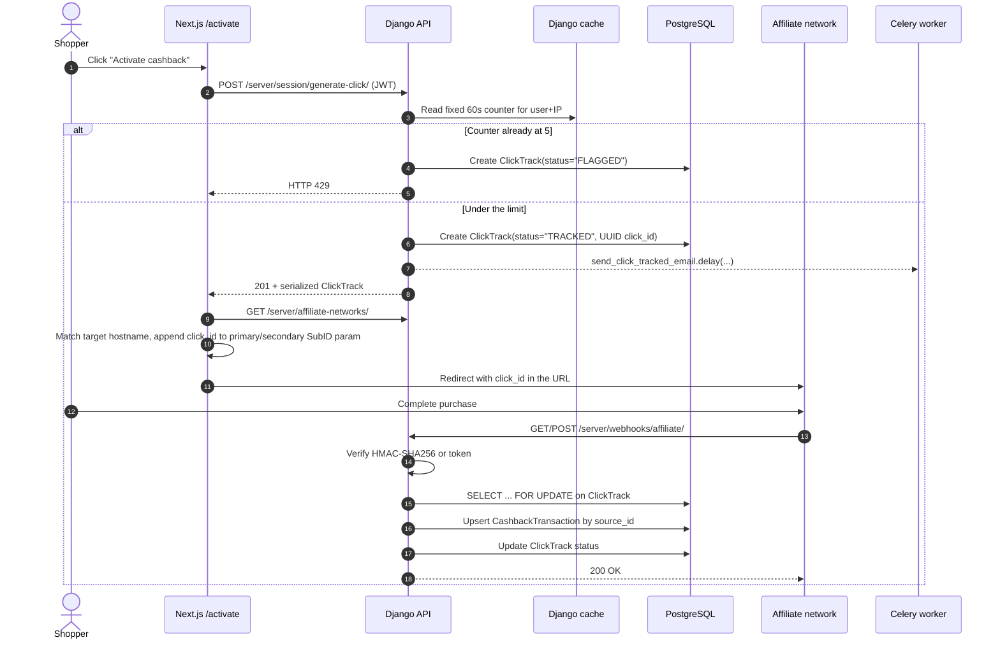

<div align="center">

<h1>DealVerse (RewardSyncHQ) — Cashback, Deals & AI Shopping Platform</h1>

**A production-ready Django REST + Next.js affiliate cashback platform featuring first-party click attribution, webhook postback ingestion, idempotent wallet ledgers, and a Manifest V3 Chrome extension.**

> **Live Product:** [rewardsynchq.com](https://rewardsynchq.com)  
> **Source Code:** [github.com/md-ajim/DealVerse](https://github.com/md-ajim/DealVerse) *(private repository — read access available on request)*  
> **Engineering Lead:** MD Ajim (Full-Stack Engineer & System Architect)

<p>
  <a href="https://rewardsynchq.com" target="_blank">
    
  </a>
  <a href="https://github.com/md-ajim/DealVerse" target="_blank">
    
  </a>
  <a href="https://github.com/md-ajim/DealVerse" target="_blank">
    
  </a>
</p>

[](https://nextjs.org/)
[](https://react.dev/)
[](https://www.typescriptlang.org/)
[](https://tailwindcss.com/)
[](https://www.djangoproject.com/)
[](https://www.django-rest-framework.org/)
[](https://docs.celeryq.dev/)
[](https://redis.io/)
[](https://www.postgresql.org/)
[](https://deepmind.google/technologies/gemini/)
[](https://developer.chrome.com/docs/extensions/)
[](https://www.docker.com/)

[Verified Scope](#-verified-scope) •
[Architecture](#-architecture) •
[Click-to-Cashback](#-click-to-cashback-flow) •
[Features](#-implemented-features) •
[Security](#-anti-fraud--webhook-security) •
[Tech Stack](#-technology-stack) •
[Quickstart](#-quickstart) •
[Testing](#-tests) •
[Known Gaps](#-known-gaps) •
[Verification](#-verification)

</div>

---

> **Documentation rule for this repository:** every technical claim below is traceable to source. If the code does not do it, it is listed under [Known Gaps](#-known-gaps) instead of being presented as a feature. The numbers in [Verified Scope](#-verified-scope) were measured with the commands in [Verification](#-verification).

## 🎯 Verified Scope

| Metric | Measured value | Method |
|---|---|---|
| Frontend TypeScript / TSX | **43,799 lines** in **307 files** | `wc -l` over `frontend/**/*.ts{,x}`, excluding `node_modules` and `.next` |
| Backend Python | **8,721 lines** in **120 files** | `wc -l` over `backend/**/*.py`, excluding `venv`, `__pycache__`, `staticfiles` |
| Chrome extension JS/HTML/JSON | **2,054 lines** in **6 files** | `wc -l` over `extension/**/*.{js,html,json}` |
| **Total counted first-party lines** | **54,574** | Sum of the three rows above |
| Frontend route files | **46** | 39 `page.tsx` + 7 `route.ts` under `frontend/app` |
| Backend route declarations | **36** `path()` / `re_path()` + **23** `router.register()` | Static count across the four first-party URL modules |
| Docker Compose services | **6** | `db`, `redis`, `backend`, `celery`, `celery-beat`, `frontend` |
| Automated test methods | **30** across **9** test classes | `backend/dealvers/tests.py`, `backend/accounts/tests.py` |

Line counts are just line counts; they are not a quality signal. The exact commands and outputs are in [Verification](#-verification).

---

## 🏗️ Architecture

The deployed shape is a Next.js frontend, a Django/DRF API, PostgreSQL, Redis as the Celery broker/result backend, and two Celery processes. Media storage is local by default; S3/CloudFront is optional.



### Components

| Layer | Implementation | Source |
|---|---|---|
| Web app | Next.js 16.0.0 App Router, React 19.2.0, Tailwind 4.1.9 | `frontend/package.json`, `frontend/app` |
| Session layer | NextAuth 4.24 with Credentials + Google providers, JWT session strategy | `frontend/lib/authOptions.js` |
| API | Django 5.1.4 + DRF 3.17.1, SimpleJWT 5.4.0 | `backend/settings/settings.py`, `backend/requirements.txt` |
| Database | PostgreSQL 15 (`postgres:15-alpine`) | `docker-compose.yaml` |
| Broker / result backend | Redis 7 (`redis:7-alpine`) | `docker-compose.yaml`, `backend/settings/settings.py` |
| Async workers | Celery 5.6.3 worker + Celery Beat | `backend/settings/settings.py`, `backend/dealvers/tasks.py` |
| Media | Local filesystem by default; S3/CloudFront when `USE_S3_STORAGE=true` | `backend/settings/settings.py` |
| Extension | Manifest V3 service worker + content script + popup, shared `config.js` | `extension/manifest.json`, `extension/config.js` |

The backend is split into three Django apps: `accounts` (auth, OTP, referrals, favorites), `dealvers` (catalog, tracking, wallet, AI, admin), and `blog`.

---

## 🔗 Click-to-Cashback Flow



Important detail: the final affiliate URL is assembled **in the browser** by `frontend/app/activate/page.tsx` (`buildAffiliateUrl`). The backend mints the `click_id` and owns the network routing rules, but it does not sign or rewrite the outbound URL server-side.

---

## ✅ Implemented Features

### Catalog and content

| Feature | What the code does | Source |
|---|---|---|
| Brand directory | Brands with cashback rate, logo/banner, categories, countries, terms, trust ratings | `backend/dealvers/brand_deals_models.py` |
| Deals and coupons | Deals with coupon codes, discount display, start/end dates, featured/trending flags | `backend/dealvers/deal_data_models.py` |
| Physical products | Product catalog with price, gallery, cashback, affiliate URL, reviews | `backend/dealvers/product_models.py` |
| Digital assets | SaaS/digital catalog with plans, platforms, trial fields, trending list | `backend/dealvers/product_models.py` |
| App rewards | Sponsored app listings with reward amount/currency | `backend/dealvers/appreward_models.py` |
| Categories, tags, countries | Taxonomy and country filtering | `backend/dealvers/core_models.py` |
| Brand reviews | 1–5 star reviews tied to a user and brand | `backend/dealvers/brand_deals_models.py` |
| Blog | DRF `ModelViewSet` for posts | `backend/blog` |
| Global search | Top 5 brands, deals, and digital assets by name | `GlobalSearchAPIView` in `backend/dealvers/views.py` |

### Tracking and money

| Feature | What the code does | Source |
|---|---|---|
| Click tracking | UUID `click_id`, user, store, IP, user agent, referrer, item type/id/name, status | `backend/dealvers/tracking_models.py` |
| Click generation | Authenticated endpoint creates `ClickTrack` and dispatches a confirmation email | `TrackingAPIView` |
| Affiliate postbacks | GET/POST webhook, signature check, `select_for_update`, idempotent upsert | `backend/dealvers/webhook_views.py` |
| Revenue share | Global `PlatformSettings.user_cashback_percentage` (default 50%) with per-brand override | `backend/dealvers/core_models.py`, `brand_deals_models.py` |
| Wallet ledger | `CashbackTransaction` with `PENDING`, `CONFIRMED`, `CANCELLED` choices | `backend/dealvers/finance_models.py` |
| Withdrawals | Request amount, method, details, status (`PENDING`, `PROCESSING`, `COMPLETED`, `REJECTED`) | `backend/dealvers/finance_models.py` |
| Payment methods | `CRYPTO`, `PAYONEER`, `BANK` | `backend/dealvers/finance_models.py` |
| Bonuses | Sign-up and referral bonus rows; unlocked after $15 confirmed shopping cashback | `backend/dealvers/signals.py`, `backend/accounts/serializers.py` |
| Claims | Missing-cashback claim submissions | `backend/dealvers/claim_models.py` |
| Wishlist / price history | Saved items, target price, price history, extension wishlist endpoint | `backend/dealvers/product_models.py`, `ExtensionWishlistAPIView` |
| Subscription tracker | Renewal date and cost per service | `backend/dealvers/finance_models.py` |

### Admin and operations

| Feature | What the code does | Source |
|---|---|---|
| Django admin | Unfold-themed admin for catalog, users, transactions, clicks, networks | `backend/dealvers/admin.py`, `backend/settings/settings.py` |
| Admin API | Separate user/withdrawal/cashback viewsets plus dashboard stats | `backend/dealvers/admin_views.py` |
| Health check | `GET /health/` returns `{"status": "ok"}` | `backend/settings/urls.py` |
| Newsletter / contact | Subscribe endpoint and contact-message model | `backend/dealvers/views.py`, `backend/dealvers/core_models.py` |
| Sitemap / indexing | Next.js sitemap and robots routes; Google Indexing API notification on `Brand`/`Deal`/`DigitalAsset` saves (the legacy sitemap-ping URLs are commented out) | `frontend/app/sitemap.ts`, `frontend/app/robots.ts`, `backend/dealvers/signals.py`, `backend/dealvers/services/google_indexing.py` |

---

## 🕸️ Affiliate Network Routing

Network routing is **database-driven**, not a hardcoded list. `AffiliateNetwork` stores a name, comma-separated domains, a primary SubID parameter, and an optional secondary parameter:

```python
class AffiliateNetwork(models.Model):
    name = models.CharField(max_length=100, unique=True)
    domains = models.TextField()
    primary_subid_param = models.CharField(max_length=50)
    secondary_subid_param = models.CharField(max_length=50, blank=True, null=True)
    is_active = models.BooleanField(default=True)
```

`frontend/app/activate/page.tsx` fetches active rows from `/server/affiliate-networks/`, matches the target hostname (exact or subdomain), and appends the `click_id`. If no row matches, it falls back to `?sub_id=<click_id>`.

**No affiliate-network fixtures or seed data are shipped in this repository.** The number of networks the system can route is therefore the number of active rows an administrator creates. The previous README's "10+ networks supported" table was not backed by code and has been removed.

Relevant files:

- `backend/dealvers/tracking_models.py` — `AffiliateNetwork`, `ClickTrack`
- `backend/dealvers/views.py` — `AffiliateNetworkViewSet` (read-only, active rows)
- `frontend/app/activate/page.tsx` — hostname matching and SubID appending
- `backend/dealvers/webhook_views.py` — reads `sub_id`, `SubId1`, `subid`, `subid1`

---

## 🛡️ Anti-Fraud & Webhook Security

| Control | Actual implementation | Caveat |
|---|---|---|
| Click velocity limit | 5 clicks per `user.id` + IP per 60 seconds using `django.core.cache`; the 6th request creates a `FLAGGED` row and returns HTTP 429 | Fixed 60-second window, not a sliding window. `CACHES` uses Redis when `REDIS_URL` or `CACHE_URL` is set (the Compose stack sets `REDIS_URL`); otherwise it falls back to per-process local memory. |
| Non-destructive audit | Over-limit clicks are stored with `status="FLAGGED"` | — |
| Webhook HMAC | `X-Affiliate-Signature` = hex HMAC-SHA256 of the raw body with `AFFILIATE_WEBHOOK_SECRET` | Two fallbacks are also accepted: `Authorization: Token <secret>` and `?token=<secret>` |
| Row locking | `ClickTrack.objects.select_for_update()` inside `transaction.atomic()` | Locks the click row, not the transaction row |
| Idempotency | Existing `CashbackTransaction` is looked up by `source_id` and updated instead of duplicated | `source_id` is the stringified click UUID |
| Reversal mapping | `APPROVED/CLEARED/COMPLETED/CONFIRMED/PAID` → `CONFIRMED`; `REVERSED/REJECTED/DECLINED` → `REJECTED` | `CashbackTransaction.STATUS_CHOICES` declares `PENDING/CONFIRMED/CANCELLED/REJECTED/FROZEN`; `ClickTrack.STATUS_CHOICES` also declares `REJECTED` |
| Signup fraud check | When 3 or more existing accounts share the same `ip_address` within 24 hours, the new signup is stored with `account_status="UNDER_REVIEW"` and its sign-up bonus is `FROZEN` | Same IP only; not a subnet calculation |
| Category blocklist | Case-insensitive substring match against alcohol, pork, adult, gambling, tobacco, interest-based finance, occult, counterfeit/pirated categories | Applied in webhook and catalog queries; it is a string blocklist, not an ML classifier |

The blocklist lives in `backend/dealvers/blocklist.py` and is enforced in `webhook_views.py`, `tasks.py`, and several catalog querysets.

---

## ⏱️ Background Jobs

Celery tasks defined in `backend/dealvers/tasks.py`:

| Task | Purpose | Scheduled by Celery Beat? |
|---|---|---|
| `send_click_tracked_email` | Send click confirmation email | No (dispatched from the click endpoint) |
| `send_cashback_earned_email` | Send confirmed-cashback email | No (dispatched from a post-save signal) |
| `process_quarterly_payouts` | Create `PENDING` withdrawal requests for confirmed balances over $5.00 | **Yes** — Jan/Apr/Jul/Oct 1 |
| `poll_affiliate_networks` | Poll the Impact API for missed conversions when `IMPACT_ACCOUNT_SID` / `IMPACT_API_TOKEN` are set | **Yes** — hourly at minute 0 |
| `check_wishlist_prices` | Scrape saved-item prices and email price-drop alerts | **Yes** — daily at 02:00 |
| `check_upcoming_renewals` | Email subscription renewal reminders | **Yes** — daily at 03:00 |

`CELERY_BEAT_SCHEDULE` (`backend/settings/settings.py`) registers all four schedules above. Times are the worker's local time zone (no `CELERY_TIMEZONE` is set). The repository does **not** set `task_acks_late=True`.

---

## 🤖 AI Features

| Feature | Implementation | Source |
|---|---|---|
| Django chatbot | `POST /server/chatbot/`, Gemini `gemini-2.0-flash`, injects the 5 latest deals with coupon codes, falls back to a plain-text deal list | `ChatbotAPIView` in `backend/dealvers/views.py` |
| Next.js chat route | `POST /api/chat`, Gemini model discovery (priority to 1.5 Flash); if no Gemini key is present, DeepSeek `deepseek-chat` when `DEEPSEEK_API_KEY` is set; injects brands, products, categories, deals with hardcoded fallbacks | `frontend/app/api/chat/route.ts` |
| Review analyzer | `POST /server/extension/analyze-reviews/`, accepts up to 15 reviews, calls `gemini-pro` with a JSON schema (`Pros`, `Cons`, `Fake_Probability_Percentage`), returns a deterministic fallback on error | `ExtensionAIReviewAnalyzerAPIView` in `backend/dealvers/views.py` |

The AI responses are model-generated. The code includes fallbacks for missing keys and request failures, but it does not guarantee factual accuracy or zero hallucination.

---

## 🧩 Chrome Extension (`extension/`)

Manifest V3, permissions `storage`, `scripting`, `activeTab`, `tabs`, host permission `https://*/*`.

| File | What it actually does |
|---|---|
| `background.js` | Imports `config.js`, fetches supported stores from the configured API URL with retry/backoff, caches them in `chrome.storage.local` for 1 hour, matches tab URLs against store domains, and messages the content script |
| `content.js` | Injects a dock/banner, cashback activation button, wishlist button, and an AI review button that scrapes review text from common selectors and calls `/extension/analyze-reviews/` |
| `popup.html` / `popup.js` | Renders store count, wishlist count, and a `totalSaved` value read from `chrome.storage.local`; links to dashboard, brands/deals, and settings |
| `config.js` | Single source for `API_BASE_URL` and `FRONTEND_URL`, loaded before `content.js`/`popup.js` and imported by the service worker |
| `manifest.json` | Declares the MV3 service worker, content script, popup, and permissions |

Caveats:

- There is **no coupon-code tester** in the extension. The word "coupon" does not appear in `extension/`.
- The API and frontend URLs live in `extension/config.js` (default `https://b5g2sob5d0.execute-api.us-east-1.amazonaws.com/production/api` and `https://rewardsynchq.com`). Edit that one file before packaging a different environment.
- `ExtensionStoresAPIView` derives the matching domain as `brand.slug + ".com"` (`backend/dealvers/views.py`), which is a simplification rather than a real domain registry.
- The popup's `totalSaved` counter is read from `chrome.storage.local`, but no code in this repository writes that key; it therefore stays at its default unless another component sets it.
- Popup links point at `/brands-deals` and `/dashboard/settings`, which exist in the App Router tree.

---

## 💻 Technology Stack

| Layer | Packages / versions | Source |
|---|---|---|
| Frontend runtime | Next.js 16.0.0, React 19.2.0, React DOM 19.2.0 | `frontend/package.json` |
| Language / styling | TypeScript ^5, Tailwind CSS ^4.1.9, Radix UI primitives, Lucide ^0.454.0 | `frontend/package.json` |
| Data / state | TanStack React Query ^5.90.6, SWR 2.3.6, Axios ^1.13.2, Zod 3.25.76 | `frontend/package.json` |
| Motion / UI extras | Framer Motion 12.23.24, react-confetti ^6.4.0, sonner ^1.7.4 | `frontend/package.json` |
| Auth client | NextAuth ^4.24.13, jwt-decode ^4.0.0 | `frontend/package.json` |
| Backend runtime | Python 3.12 (`python:3.12-slim`), Django 5.1.4, DRF 3.17.1 | `backend/Dockerfile`, `backend/requirements.txt` |
| Auth server | SimpleJWT 5.4.0, drf-social-oauth2 3.1.0, django-oauth-toolkit 3.0.1 | `backend/requirements.txt`, `backend/settings/settings.py` |
| Async | Celery 5.6.3, Redis 7 | `backend/requirements.txt`, `docker-compose.yaml` |
| Database driver | psycopg2-binary 2.9.12 | `backend/requirements.txt` |
| Admin | django-unfold 0.55.2, django-import-export 4.4.1 | `backend/requirements.txt` |
| Media | django-storages 1.14.6, boto3 1.43.35 (optional S3) | `backend/requirements.txt`, `backend/settings/settings.py` |
| Email | django-anymail 15.0 with the Mailtrap backend | `backend/settings/settings.py` |
| Web server | Gunicorn 26.0.0 | `backend/requirements.txt` |
| Container | Docker Compose, Node 22 Alpine, Python 3.12 Slim | `docker-compose.yaml`, `frontend/Dockerfile`, `backend/Dockerfile` |

---

## 📂 Repository Layout

```text
DealVerse/
├── frontend/
│   ├── app/                     # 39 page.tsx + 7 route.ts (46 route files)
│   │   ├── (shop)/products/     # /products and /products/[slug]
│   │   ├── activate/            # click_id generation + SubID URL assembly
│   │   ├── brands-deals/        # brand/deal directory
│   │   ├── cashback/            # cashback hub and /cashback/brands/[slug]
│   │   ├── digital-asset/       # digital/SaaS catalog
│   │   ├── digital-brands/      # digital brand directory
│   │   ├── apps-cashback/       # app rewards
│   │   ├── physical-brands/     # physical merchant directory
│   │   ├── dashboard/           # wallet, claims, wishlist, subscriptions, referrals, settings
│   │   ├── admin/               # admin UI pages
│   │   └── api/                 # auth, chat, deals, mega-menu, products, redirect, revalidate
│   ├── components/              # UI and business components
│   ├── lib/                     # API clients, auth options, schemas, types
│   └── public/                  # OpenGraph images and static assets
│
├── backend/
│   ├── accounts/                # custom user, auth, OTP, referrals, fraud check
│   ├── blog/                    # blog ViewSet
│   ├── dealvers/
│   │   ├── brand_deals_models.py
│   │   ├── deal_data_models.py
│   │   ├── product_models.py
│   │   ├── appreward_models.py
│   │   ├── finance_models.py
│   │   ├── tracking_models.py
│   │   ├── claim_models.py
│   │   ├── core_models.py
│   │   ├── views.py
│   │   ├── webhook_views.py
│   │   ├── track_views.py
│   │   ├── tasks.py
│   │   ├── signals.py
│   │   ├── blocklist.py
│   │   ├── admin.py
│   │   └── urls.py
│   ├── settings/                # settings.py, urls.py, wsgi.py, asgi.py
│   └── Dockerfile
│
├── extension/                   # manifest.json, config.js, background.js, content.js, popup.*
├── architecture-diagrams/       # PNG diagrams
├── docs/COOLIFY_DEPLOYMENT.md   # deployment/operations guide
├── docker-compose.yaml          # 6 services
└── README.md
```

---

## 🚀 Quickstart

### Option 1 — Docker Compose (6 services)

```bash
git clone https://github.com/md-ajim/DealVerse.git
cd DealVerse

cp .env.production.example .env
# Fill in the required secrets in .env

docker compose up -d --build
```

Services started: `db` (Postgres 15), `redis` (Redis 7), `backend` (Gunicorn), `celery`, `celery-beat`, `frontend` (Next.js standalone).

Local endpoints:

- Frontend: `http://localhost:3000`
- API: `http://localhost:8000/server/`
- Health: `http://localhost:8000/health/`

The backend entrypoint waits for the database, runs `migrate` and `collectstatic`, then starts Gunicorn (`backend/entrypoint.sh`). It does **not** seed catalog data.

### Option 2 — Native development

Backend:

```bash
cd backend
python -m venv venv
source venv/bin/activate          # Windows: venv\Scripts\activate
pip install -r requirements.txt

python manage.py migrate
python populate_countries.py
python populate_deals.py

python manage.py runserver 0.0.0.0:8000
```

Celery worker (separate terminal):

```bash
cd backend
source venv/bin/activate
celery -A settings worker --loglevel=info
```

Celery Beat (only needed for the quarterly payout schedule):

```bash
cd backend
source venv/bin/activate
celery -A settings beat --loglevel=info
```

Frontend:

```bash
cd frontend
npm install

cat <<EOF > .env.local
NEXT_PUBLIC_API_BASE_URL=http://localhost:8000/server
NEXTAUTH_SECRET=development_secret_key_dealverse_32chars
NEXTAUTH_URL=http://localhost:3000
EOF

npm run dev
```

Chrome extension:

1. Open `chrome://extensions/`.
2. Enable **Developer mode**.
3. Choose **Load unpacked** and select the `extension/` directory.
4. Edit `API_BASE_URL` / `FRONTEND_URL` in `extension/config.js` if you are not using the default API Gateway and frontend URLs.

---

## 🧪 Tests

The repository contains 30 test methods in 9 classes:

| File | Classes | What is covered |
|---|---|---|
| `backend/dealvers/tests.py` | `RewardSyncHQAPITests`, `CountryImportAdminTests`, `BrandCountryImportAdminTests`, `CashbackStatusChoiceTests`, `CashbackClaimModelTests`, `WebhookSignatureTests`, `AffiliateWebhookEndpointTests`, `ClickRateLimitTests` | Brand/product/app-reward list endpoints, extension stores, withdrawal creation, trending digital assets, country import admin actions, declared transaction/click statuses, claim `__str__`, HMAC/token signature verification, webhook create/update/404 and GET postbacks, 6th-click rate limiting |
| `backend/accounts/tests.py` | `AuthTestCase` | Login requires OTP, invalid credentials, registration flow, forgot/reset password flows |

Run them with:

```bash
cd backend
python manage.py test dealvers accounts
```

The webhook and rate-limit tests run against SQLite in CI-style runs; point `DATABASE_URL` at a disposable database if your default environment uses a shared one. Row-level locking itself is exercised only incidentally (SQLite does not implement `SELECT ... FOR UPDATE`), so concurrent-postback behaviour is not proven by these tests.

---

## ⚠️ Known Gaps

These are source-verified limitations, listed here instead of being presented as features:

1. **No seeded affiliate networks.** Routing works only for `AffiliateNetwork` rows created in the admin. No fixtures ship with the repo.
2. **Rate limiting is a fixed 60-second window.** `CACHES` uses Redis when `REDIS_URL`/`CACHE_URL` is set (Compose sets `REDIS_URL`); otherwise it is per-process local memory. The counter is not a sliding window and is not tested against multiple workers.
3. **`acks_late` is not enabled.** Task acknowledgement settings are not configured, so a worker crash can lose an in-flight task.
4. **S3 is optional, not the default.** Media is served from the local filesystem unless `USE_S3_STORAGE=true` is set.
5. **The affiliate URL is built client-side.** The backend mints the click ID and stores network rules, but the browser performs the final SubID rewrite. Attribution identifiers are not signed.
6. **The extension has no coupon tester.** It supports cashback activation, wishlist, and AI review analysis only.
7. **`totalSaved` is never written.** The popup reads it from `chrome.storage.local`, but nothing in this repository sets it.
8. **Webhook status handling is minimal.** Unknown status strings fall through to `PENDING`; there is no per-network adapter layer.
9. **AI is best-effort.** The Django chatbot and review analyzer return static fallbacks when keys or requests fail. The Next.js `/api/chat` route returns HTTP 500 when neither `GEMINI_API_KEY` nor `DEEPSEEK_API_KEY` is configured.
10. **No guest attribution.** Click generation requires an authenticated user, so anonymous shoppers are not tracked.
11. **No payment gateway.** Withdrawals are recorded as `WithdrawalRequest` rows and processed manually; there is no Stripe/PayPal/Payoneer payout integration in the code.
12. **Concurrent postback locking is untested.** The webhook uses `select_for_update()`, but the automated tests run on SQLite, which does not enforce row locks, so concurrency is not proven by the suite.

---

## 📐 Verification

Run these from the repository root. The outputs below were captured on the current checkout.

### Line counts

```bash
find frontend -type f \( -name "*.ts" -o -name "*.tsx" \) \
  ! -path "*/node_modules/*" ! -path "*/.next/*" -print0 | xargs -0 cat | wc -l
# 43799

find backend -type f -name "*.py" \
  ! -path "*/venv/*" ! -path "*/__pycache__/*" ! -path "*/staticfiles/*" \
  -print0 | xargs -0 cat | wc -l
# 8721

find extension -type f \( -name "*.js" -o -name "*.html" -o -name "*.json" \) \
  -print0 | xargs -0 cat | wc -l
# 2054
```

File counts:

```bash
find frontend -type f \( -name "*.ts" -o -name "*.tsx" \) \
  ! -path "*/node_modules/*" ! -path "*/.next/*" | wc -l
# 307

find backend -type f -name "*.py" \
  ! -path "*/venv/*" ! -path "*/__pycache__/*" ! -path "*/staticfiles/*" | wc -l
# 120
```

### Frontend routes

```bash
find frontend/app -name page.tsx | wc -l   # 39
find frontend/app -name route.ts | wc -l   # 7
```

### Backend route declarations

```bash
for f in backend/settings/urls.py backend/dealvers/urls.py \
         backend/accounts/urls.py backend/blog/urls.py; do
  printf "%s: " "$f"
  grep -cE "^\s*(path|re_path)\(" "$f"
done
# backend/settings/urls.py: 7
# backend/dealvers/urls.py: 15
# backend/accounts/urls.py: 13
# backend/blog/urls.py: 1

for f in backend/dealvers/urls.py backend/blog/urls.py; do
  printf "%s: " "$f"
  grep -c "router.register" "$f"
done
# backend/dealvers/urls.py: 22
# backend/blog/urls.py: 1
```

### Compose services

```bash
grep -nE "^  [a-z-]+:" docker-compose.yaml
# db, redis, backend, celery, celery-beat, frontend
```

### Tests

```bash
grep -c "    def test" backend/dealvers/tests.py   # 24
grep -c "    def test" backend/accounts/tests.py  # 6
```

### Stack versions

```bash
grep -E '"(next|react|react-dom|next-auth|tailwindcss|typescript)"' frontend/package.json
grep -E "^(Django|djangorestframework|celery|redis|gunicorn|django-anymail|django-storages)==" backend/requirements.txt
```

---

## 👨‍💻 Author

**MD AJIM**
*Full-Stack Systems Engineer (Django | Next.js | Distributed Systems | DevOps)*
Barisal, Bangladesh • Open to Global Relocation & Remote Opportunities

- 🌐 Portfolio: [mdajim.work](http://mdajim.work)
- 💼 LinkedIn: [linkedin.com/in/md-ajim](https://www.linkedin.com/in/md-ajim/)
- 🐙 GitHub: [github.com/md-ajim](https://github.com/md-ajim)
- 📧 Email: [ajim@mdajim.work](mailto:ajim@mdajim.work)

---

<div align="center">

*Django + Next.js cashback platform. Claims above are limited to what the source code does.*

</div>
# rewardsynchq
# rewardsynchq
