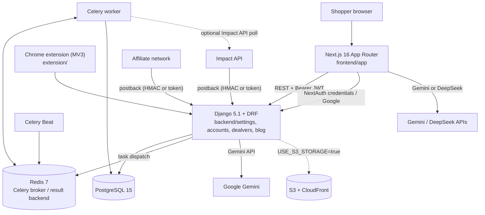

# RewardSyncHQ / DealVerse — Verified Architecture

> **Live Product:** [rewardsynchq.com](https://rewardsynchq.com)  
> **Source Code:** [github.com/md-ajim/DealVerse](https://github.com/md-ajim/DealVerse) *(private repository — read access available on request)*  
> **Engineering Lead:** MD Ajim (Full-Stack Engineer & System Architect)

This document describes the architecture that is actually implemented in this repository. It is intentionally narrower than a design proposal: components that do not exist in code are not shown. File references point to the implementation.

## 1. Runtime topology

## 2. Frontend

- **Framework:** Next.js 16.0.0 App Router with React 19.2.0 (`frontend/package.json`).
- **Routes:** 39 `page.tsx` files and 7 `route.ts` handlers (`frontend/app`). The URL tree includes `/`, `/brands-deals`, `/cashback`, `/cashback/brands/[slug]`, `/products`, `/digital-asset`, `/digital-brands`, `/apps-cashback`, `/physical-brands`, `/activate`, `/dashboard/*`, `/admin/*`, `/blog`, auth pages, and policy pages.
- **Server data fetching:** pages such as `frontend/app/page.tsx` fetch catalog data from the Django API during server rendering.
- **API base URL:** `frontend/lib/api-base.ts` uses `NEXT_PUBLIC_API_BASE_URL` in the browser and `INTERNAL_API_BASE_URL` on the server when set. The default is `http://localhost:8000/server`.
- **Sessions:** NextAuth 4.24 (`frontend/lib/authOptions.js`) with a Credentials provider and a Google provider. Credentials are posted to Django `/server/auth/login/` or `/server/auth/verify-otp/`; Google sign-in posts an ID token to `/server/auth/google-login/`. The session strategy is JWT (30 days), and the Django access/refresh tokens are stored in the NextAuth JWT.
- **API route handlers:** `frontend/app/api/` contains auth, chat, deals, mega-menu, outgoing redirect, products, and revalidate handlers. Not every browser request goes through these handlers; many client components call the Django API directly with a Bearer token.
- **Attribution UI:** `frontend/app/activate/page.tsx` creates the click through Django, fetches active `AffiliateNetwork` rows, and appends the `click_id` to the network's primary/secondary SubID parameter in the browser. If no network matches, it uses `?sub_id=<click_id>`.

## 3. Backend

Django apps (`backend/settings/settings.py`):

| App | Responsibility |
|---|---|
| `accounts` | Custom user model, registration, OTP login, JWT, Google login, password reset, referrals, favorites, signup fraud check |
| `dealvers` | Catalog, tracking, webhooks, wallet, withdrawals, claims, admin API, AI endpoints, newsletter |
| `blog` | Blog posts through a DRF `ModelViewSet` |

Route layout:

- `backend/settings/urls.py`: `health/`, `admin/`, `server/auth/`, `server/blog/`, `auth/` (social auth), `server/`.
- `backend/accounts/urls.py`: 13 auth endpoints, including `/server/auth/login/`, `/verify-otp/`, `/google-login/`, `/token/access/`, `/token/refresh/`.
- `backend/dealvers/urls.py`: 22 `DefaultRouter` registrations plus 14 explicit endpoints (`session/generate-click/`, `webhooks/affiliate/`, `extension/*`, `search/`, `chatbot/`, `newsletter/subscribe/`, and others).

Core models are split across:

- `backend/dealvers/brand_deals_models.py` — `Brand`, `BrandCoupon`, `BrandReview`, `PopularBrand`
- `backend/dealvers/deal_data_models.py` — `Deal`
- `backend/dealvers/product_models.py` — `Product`, `DigitalAsset`, `TrendingDigitalAsset`, `PriceHistory`, `SavedItem`
- `backend/dealvers/appreward_models.py` — `AppReward`
- `backend/dealvers/finance_models.py` — `CashbackTransaction`, `PaymentMethod`, `WithdrawalRequest`, `SubscriptionTracker`
- `backend/dealvers/tracking_models.py` — `ClickTrack`, `AffiliateNetwork`
- `backend/dealvers/claim_models.py` — cashback claims
- `backend/dealvers/core_models.py` — `Category`, `Tag`, `Country`, `PlatformSettings`, newsletter and contact models

## 4. Persistence

- **PostgreSQL 15** is the primary database (`postgres:15-alpine` in `docker-compose.yaml`).
- **Media** is stored on the local filesystem by default. When `USE_S3_STORAGE=true`, `django-storages` switches default and static storage to S3, using `AWS_S3_CUSTOM_DOMAIN` for the public URL (`backend/settings/settings.py`).
- **Redis** is configured as the Celery broker and result backend (`CELERY_BROKER_URL`, `CELERY_RESULT_BACKEND`). `CACHES` also uses Redis when `REDIS_URL` or `CACHE_URL` is set (the Compose stack sets `REDIS_URL`); otherwise it falls back to per-process local memory. The click limiter is still a fixed 60-second counter, not a sliding window.

## 5. Click and conversion flow

1. The authenticated browser calls `POST /server/session/generate-click/` (`TrackingAPIView`).
2. The view checks a fixed 60-second cache counter keyed by user ID + IP. When the counter is already at 5, it writes a `ClickTrack` with `status="FLAGGED"` and returns HTTP 429.
3. Otherwise it creates a `ClickTrack` with a UUID `click_id`, status `TRACKED`, and dispatches `send_click_tracked_email` through Celery.
4. The browser fetches active `AffiliateNetwork` rows and rewrites the partner URL with the `click_id` in the configured SubID parameter.
5. The affiliate network sends a GET or POST postback to `/server/webhooks/affiliate/`.
6. `verify_signature` accepts an HMAC-SHA256 `X-Affiliate-Signature`, `Authorization: Token <secret>`, or `?token=<secret>`.
7. The handler reads the click ID, commission, and status; acquires `select_for_update()` on the `ClickTrack`; applies the global or per-brand revenue share; applies the category blocklist; and upserts `CashbackTransaction` by `source_id`.
8. The `ClickTrack` is set to `CONVERTED` or `REJECTED`.

## 6. Asynchronous work

Celery tasks (`backend/dealvers/tasks.py`):

- `send_click_tracked_email`
- `send_cashback_earned_email`
- `process_quarterly_payouts`
- `poll_affiliate_networks` (Impact API, only if credentials are configured)
- `check_wishlist_prices`
- `check_upcoming_renewals`

`CELERY_BEAT_SCHEDULE` (`backend/settings/settings.py`) registers:

- `quarterly-payouts` — first day of January, April, July, October
- `hourly-affiliate-poll` — every hour at minute 0
- `daily-wishlist-prices` — daily at 02:00
- `daily-subscription-renewals` — daily at 03:00

No `CELERY_TIMEZONE` is configured, so the worker's local time applies. `task_acks_late` is not enabled.

## 7. External integrations

- **Affiliate networks:** inbound webhooks and optional Impact API polling. Outbound network selection is driven by `AffiliateNetwork` database rows; no network fixtures are seeded.
- **AI:** Django chatbot uses Gemini `gemini-2.0-flash`; the review analyzer uses `gemini-pro`; the Next.js `/api/chat` route prefers a Gemini 1.5 Flash model and uses DeepSeek only when no Gemini key is configured and `DEEPSEEK_API_KEY` is present.
- **Email:** `django-anymail` with the Mailtrap backend (`EMAIL_BACKEND`, `ANYMAIL` in `backend/settings/settings.py`).
- **Search indexing:** `backend/dealvers/services/google_indexing.py` and the Next.js sitemap/robots routes (`frontend/app/sitemap.ts`, `frontend/app/robots.ts`). The legacy sitemap-ping URLs in `ping_search_engines` are commented out; the Google Indexing API notification remains active.
- **Chrome extension:** `extension/config.js` centralises `API_BASE_URL` and `FRONTEND_URL`; the service worker imports it and the content script/popup load it first.

## 8. Deployment

`docker-compose.yaml` defines six services: `db`, `redis`, `backend`, `celery`, `celery-beat`, and `frontend`. The backend image is `python:3.12-slim`; the frontend image is Node 22 Alpine with Next.js standalone output. Deployment/operations notes live in `docs/COOLIFY_DEPLOYMENT.md`.

## 9. Deliberate non-claims

The following are **not** part of the current implementation and are not shown as architecture:

- A sliding-window or multi-worker-verified rate limiter (the current limiter is a fixed 60-second counter)
- Seeded support for a fixed list of affiliate networks
- Guest attribution for anonymous shoppers (click generation requires authentication)
- A payment gateway; withdrawals are recorded for manual processing
- Celery `acks_late=True`
- Server-side signing or rewriting of outbound affiliate URLs
- Coupon-code testing in the Chrome extension
- A test that proves row-lock behaviour under concurrent postbacks (the suite runs on SQLite)
