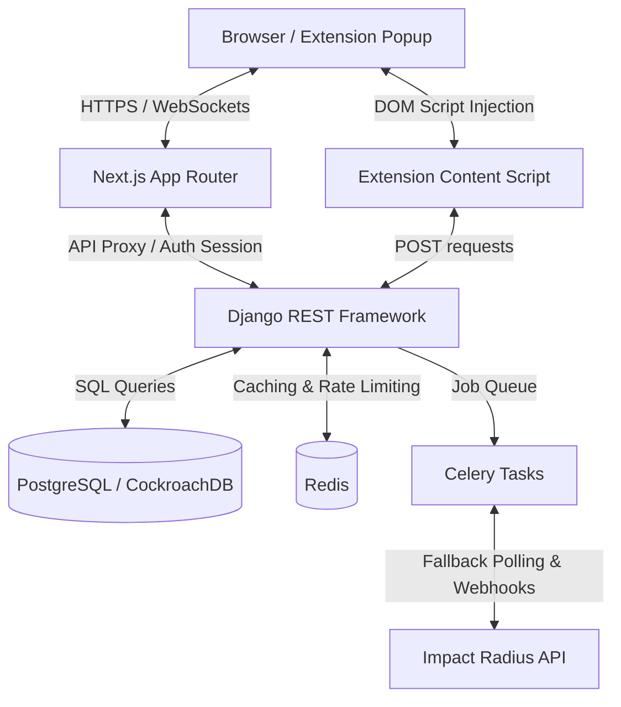

# RewardSyncHQ (DealVerse) — Deep Technical Research Report

This document presents a comprehensive, detailed technical analysis of the RewardSyncHQ (DealVerse) codebase, covering the backend (Django REST Framework), the frontend (Next.js App Router), the Browser Extension (MV3 Chrome Extension), and specific implementation choices, patterns, and code findings.

---

## 1. System Architecture & Tech Stack

The application is structured as a modern, decoupled platform:



### Technical Summary
* **Backend**: Django (v5.1) + Django REST Framework (DRF). Simple JWT handles stateless token auth. Celery manages asynchronous jobs, email dispatches, and periodic syncs.
* **Frontend**: Next.js (App Router) + React + Tailwind CSS. Component system is structured via Shadcn UI. State and animations are driven by Framer Motion. Data visualization uses Recharts. NextAuth manages sessions.
* **Extension**: Chrome Extension Manifest V3 (MV3). Uses background service workers, content scripts, and a custom CSS rendering engine for DOM UI overlays.
* **Storage & DB**: Supports SQLite3 for local testing, PostgreSQL for production, and **CockroachDB** (via `django-cockroachdb`) for high-availability distributed database clustering. Uses AWS S3 for media storage via `django-storages` and `boto3`.
* **Rate Limiting**: Redis serves as the Celery broker, caching layer, and temporary rate-limiter for anti-fraud.

---

## 2. Backend Application Directory Research

The backend contains four primary modules/apps: `settings`, `accounts`, `dealvers`, and `blog`.

```
backend/
├── manage.py
├── settings/           # Main config (Settings, URLs, Celery, WSGI/ASGI)
├── accounts/           # User authentication, OTPs, profiles, fraud filters
├── dealvers/           # Core logic: Products, Brands, Claims, Payouts, Analytics
└── blog/               # Core blogging engine (small views & models)
```

### A. The `settings` Directory (Project Core)
* **`settings.py`**: Manages environment loading, CORS/CSRF headers, DRF configuration (Simple JWT Bearer tokens), DB drivers, and Celery task configurations.
* **`urls.py`**: Maps high-level routes:
  * `/admin/` &rarr; Django Admin (enhanced with the premium `django-unfold` modern dashboard theme)
  * `/server/auth/` &rarr; `accounts.urls`
  * `/server/blog/` &rarr; `blog.urls`
  * `/auth/` &rarr; `drf_social_oauth2` (Social Auth Providers)
  * `/server/` &rarr; `dealvers.urls` (Core API endpoints)
* **`celery.py`**: Instantiates and configures the Celery application bound to the Redis broker.

### B. The `accounts` App (User Management & Fraud Prevention)
Handles customer registration, security settings, profiles, and initial registration verification.

#### Database Models
1. **`User` (inherits `AbstractUser`)**:
   * Extends Django's default user with `profile_pic`, `phone_number`, `fullName`, `countryCode`, and `terms`.
   * **Referrals**: `referral_code` (Char, unique) and `referred_by` (FK to `self`).
   * **Fraud Fields**: `ip_address` (IPField), `device_fingerprint` (String), and `account_status` (`ACTIVE`, `UNDER_REVIEW`).
   * **Preferences**: `receive_commission_updates` (Bool), `receive_promotional_offers` (Bool), `theme_mode` (Light/Dark/System), and `two_factor_enabled` (Bool).
   * **Referral Generation**: Overrides the `save` method to generate a unique referral code: `REF` followed by 10 random alphanumeric characters (designed to avoid CockroachDB integer key overflow).
2. **`UserFavorite`**:
   * Maps a `user` to a `dealvers.Brand` store. Set with a unique constraint on `(user, brand)`.
3. **`OTP`**:
   * Verification records storing `email`, verification `code`, `is_used` status, and an `expires_at` timestamp (default: 10 minutes expiry).

#### Security & Authentication Flows
* **2FA Sign-up & Verification**:
  * During signup (`RegisterAPIView`), the user is created with `is_active=False` and a 6-digit OTP is sent to their email.
  * The user verifies via `VerifyOTPAPIView` which marks the OTP as used, sets `user.is_active=True`, and returns JWT access and refresh tokens.
* **2FA Secure Login**:
  * `LoginAPIView` validates credentials. If correct, instead of returning JWTs, it returns a 2FA OTP sent to their email.
  * The user must hit `VerifyOTPAPIView` with their code to obtain active JWT access tokens.
* **IP-based Fraud Check (`fraud_utils.py`)**:
  * When a user registers (or uses Google OAuth), the system checks if the client `ip_address` has been used for other registrations in the last 24 hours.
  * If the count is **>= 3**, `is_flagged` is marked `True`. The user is created with `account_status = 'UNDER_REVIEW'`, and their signup/referral bonuses are flagged as `FROZEN` instead of `PENDING`.
* **Google Social OAuth (`GoogleLoginAPIView`)**:
  * Decodes and verifies the Google ID token.
  * Downloads the user's profile image asynchronously via `requests.get` and wraps it in a Django `ContentFile` before saving.
  * Grants a **$5.00 Sign-up Bonus** (`CashbackTransaction`) to the user.
  * If referred, grants a **$5.00 Referral Bonus** to the referrer.

### C. The `dealvers` App (Core Business Logic)
The engine managing cashback calculations, store networks, deals, manual claims, and analytics.

#### Database Models
1. **`Category` & `Tag`**: Categorize products and digital tools. Includes `is_digital` flag to distinguish SaaS/Software from retail.
2. **`Country`**: Stores codes (ISO 3166-1 alpha-2) and emojis for country-based filtering.
3. **`Brand` (Retailer)**:
   * Holds `logo_url`, `banner_url`, `cashback_total` (current rate), `cashback_previous` (for comparisons), `exclusive` flags, and `is_partner` flags.
4. **`Product` & `DigitalAsset`**:
   * Represent retail goods and SaaS items. Includes pricing, original price, cashback percentages, and coupon codes.
5. **`SavedItem` (Wishlist)**:
   * Maps `(user, url)`. Used by the browser extension to track product listings. Stores `initial_price`, `target_price`, and `current_price` to monitor price drops.
6. **`PriceHistory`**:
   * Tracks daily price checkpoints for crawled URLs (`url`, `price`, `date_recorded`).
7. **`CashbackTransaction`**:
   * Records user earnings: `amount`, `status` (`PENDING`, `CONFIRMED`, `CANCELLED`), and `source_name` (e.g. "Amazon Purchase").
8. **`WithdrawalRequest`**:
   * Records cashout requests: `amount`, `status` (`PENDING`, `PROCESSING`, `COMPLETED`, `REJECTED`), `payment_method` (Crypto, Payoneer, Bank), and `payment_details`.
9. **`ClickTrack`**:
   * Creates a secure `click_id` (UUID4) when a user redirects to a store. This `click_id` is sent to the affiliate network as `SubID1`. Also stores fraud tracking metrics (IP, User Agent, Referrer).

#### Core API Features & Webhooks
* **Affiliate Webhook Callback (`affiliate_webhook` in `webhook_views.py`)**:
  * Receives transaction logs from affiliate tracking networks (e.g., Impact.com).
  * Validates calls via HMAC (using `HTTP_X_AFFILIATE_SIGNATURE`) or fallback tokens.
  * Maps the conversion's `sub_id` to the original `ClickTrack` record.
  * Fetches the dynamic user revenue share from `PlatformSettings` (e.g. 50%) and awards `commission * user_share_percentage` to the user.
  * Updates or creates the user's `CashbackTransaction`.
* **Islamic Guidelines Blocklist (`blocklist.py`)**:
  * Enforces category filtering to exclude products violating Islamic rules.
  * Blocklisted topics: *Alcohol, Pork, Adult/Sexual Wellness, Dating/Hookup Apps, Conventional Banking/Loans/Interest-based Credit Cards, Gambling/Betting/Casinos, Tobacco/Vaping/Cannabis, Magic/Occult/Astrology, and Stolen/Counterfeit Goods*.
  * Used dynamically in viewsets (`exclude_prohibited` filters product listings) and webhook conversions (if a conversion matches a blocked category, user cashback is set to 0, status is marked `REJECTED`, and the reason `"Islamic principles blocklist"` is saved).
* **Unified Product Price & Review Analyzer (`UnifiedProductAnalyzerView`)**:
  * Receives a product URL, scrapes details, updates `PriceHistory`, and runs pricing checks against the 30-day average:
    * If price is `< 95%` of average &rarr; **BUY** verdict.
    * If price is `> 105%` of average &rarr; **WAIT** verdict.
    * Else &rarr; **NEUTRAL** verdict.
  * Processes reviews with the Gemini API to extract pros, cons, and fake review probability percentages (using a structured system prompt asking for a strict JSON output).

#### Background Celery Workers (`tasks.py`)
* **`poll_affiliate_networks`**: Queries Impact Radius API directly on an hourly cron schedule to capture missing conversions that failed to deliver via webhooks. Matches them to click IDs and enforces blocklist filters.
* **`process_quarterly_payouts`**: Runs quarterly to calculate user balances (`Confirmed - Withdrawn`). If a user has `> $5.00` available, it generates a pending manual payout withdrawal request.
* **`check_wishlist_prices`**: Runs daily, crawling all active `SavedItem` URLs. If a price drops below the user's `target_price`, it sends an email alert (`price_drop.html`).
* **`check_upcoming_renewals`**: Iterates through active SaaS subscriptions renewing tomorrow, emails a reminder, and automatically advances the renewal date by one month.

---

## 3. Frontend Architecture & Page Research

The frontend application (`frontend/app`) is designed using Next.js App Router with server-side rendering (SSR), incremental static regeneration (ISR), and dynamic client components.

```
frontend/app/
├── layout.tsx
├── page.tsx               # Homepage (Hero, search, newsletter, featured carousels)
├── activate/              # Cashback activation page with ad-blocker baiting
├── analyzer/              # AI price & review analyzer page
├── apps-cashback/         # Mobile app task/survey rewards
├── auth/                  # Registration, login, password resets
├── brands-deals/          # Brands directory & active coupons listing
├── dashboard/             # User hub (Wallet, transactions, referrals, wishlist)
│   ├── wishlist/          # Tracked wishlist prices from extension
│   └── ...
├── digital-asset/         # SaaS products & software deals listing
└── support/               # Contact forms & help desk categories
```

### Key Page Workflows
1. **Homepage (`page.tsx`)**:
   * Uses Framer Motion for smooth entrances.
   * Includes a dynamic `HeroSearchBar` and a newsletter subscribe input linking to `/api/newsletter/subscribe/`.
   * Integrates static data fetching from `/api/categories/` cached via Next.js options (`{ revalidate: 3600 }`).
2. **AI Price & Review Analyzer (`analyzer/client.tsx`)**:
   * Includes an input form that triggers `POST /api/unified-analyzer/`.
   * Displays price trends using Recharts `AreaChart` with smooth gradients.
   * Displays AI analysis metrics, including a progress bar for fake review probability and parallel cards for Pros and Cons.
   * Provides a "Track Price" option that prompts the user for a target price and logs it to `/api/extension/wishlist/`.
3. **Cashback Activation Transition Page (`activate/page.tsx`)**:
   * Receives `brand`, `product`, `deal`, or `app` slugs and fires `generateClickTrack` to the backend.
   * **Ad-Blocker Protection**: Checks client-side for ad-blockers by appending a bait div with ad-network classes (e.g. `adsbox`, `ad-placement`). If detected, it displays a warning dialog and stops the automated redirect, prompting the user to disable it to ensure cashback tracking functions.
   * Attaches the secure `click_id` (used as SubID) depending on the affiliate network (Impact, CJ, Awin, Rakuten, Admitad, FlexOffers, Pepperjam, etc.).
4. **User Dashboard Hub (`dashboard/page.tsx`)**:
   * Implements a custom data hook (`use-dashboard-data.ts`) to fetch dashboard views in parallel:
     ```typescript
     const [financials, referral, favorites, transactions, withdrawals, profile, paymentMethods] = await Promise.all([
         getFinancialAnalytics(token),
         getReferralInfo(token),
         getFavoriteBrands(token),
         getCashbackTransactions(token),
         getWithdrawalRequests(token),
         getUserProfile(token),
         getPaymentMethods(token),
     ]);
     ```
   * Renders financial trends with Recharts (Area charts for earnings, Pie/Donut charts for store breakdowns).
   * Displays an interactive "Refer & Earn" widget with copyable referral links and social sharing shortcuts.
5. **Wishlist Tracking Page (`dashboard/wishlist/page.tsx`)**:
   * Lists wishlist items saved via the extension using current, target, and initial prices. Let's users manage items or clear them via `DELETE` requests to `/api/extension/wishlist/`.
6. **Support Help Desk (`support/page.tsx`)**:
   * Features a contact form, emergency warnings, support categories, and collapsible FAQ lists.
7. **AI Shopping Recommendation Assistant (`AIAssistant.tsx` & `/api/chat/route.ts`)**:
   * **Dynamic Catalog Feeding**: Fetches active brands, products, and categories in parallel with a 300-second cache TTL. Falls back to hardcoded snapshots if the Django backend is offline.
   * **System Prompt Formatting**: Feeds the fetched catalog into a structured system prompt, teaching the AI assistant real cashback percentages and partner details.
   * **Multi-Model Support**: Checks for `GEMINI_API_KEY` or `DEEPSEEK_API_KEY`. If Gemini is active, it queries the Google models API list, selecting the optimal model (e.g. `gemini-1.5-flash` or `gemini-1.5-pro`). For DeepSeek, it formats completions matching `deepseek-chat`.
   * **Global Floating UI FAB**: Rendered as a premium animated floating action bubble (`Bot` icon) on the bottom right of the Next.js page layout. Clicking reveals a chat sidebar featuring quick suggestions.


### Custom React Hooks (`frontend/hooks`)
* **`useReturnPing.ts`**: Implements first-party cookie fallback. Reads the `rshq_click_id` cookie on session loading and pings the backend `/api/session/return-ping/` to mark the session as `RETURNED`.
* **`useRealtimeUpdates.ts`**: Opens a WebSocket connection to `ws://localhost:8000/ws/cashback/` to receive instant transaction update notifications. Invalidates TanStack React Query queries to refresh the cache. Falls back to 30-second polling intervals if disconnected.

### NextAuth Integration (`lib/authOptions.js`)
* **Google Authorization**: Intercepts sign-in, reads the `rshq_referral_code` cookie, and fires it over to `/auth/google-login/` on the Django backend to link referrers.
* **Credentials & 2FA**: Handles standard logins. If the backend signals `2FA_REQUIRED`, it triggers the OTP card state in `LoginCard.tsx` (using shadcn InputOTP boxes).
* **Token Rotation**: Inside the `jwt` callback, if the token is expired, it automatically calls `refreshAccessToken` on `/auth/token/refresh/` to renew the JWT session.

---

## 4. Search Engine Optimization (SEO) & Metadata

The project implements comprehensive, automated SEO best practices, structured to maximize search visibility and indexability.

### A. Programmatic URL Canonicalization (`lib/seo.ts`)
To prevent duplicate content penalties (e.g. from affiliate parameters or hash fragments), the system uses a custom utility (`getCanonicalUrl`) to strip unwanted parameters and format paths deterministically:
* *Brands*: `/cashback/brands/${cleanSlug}`
* *Apps*: `/apps-cashback/${cleanSlug}`
* *Products*: `/products/${cleanSlug}`
* *SaaS Tools*: `/digital-asset/${assetSlug}`

### B. Robots Rule Configuration (`robots.ts`)
Configures search engine crawl limits dynamically:
* **Allowed**: All public listing and information pages (`/`, `/products`, `/digital-asset`, `/apps-cashback`, `/blog`).
* **Disallowed**: Transitional and private user/auth directories (`/dashboard/`, `/api/`, `/activate/`, `/admin/`, `/join/`) to protect page loads and crawler budgets.
* **Crawl-Delay**: Set to `2` seconds to prevent crawler rate-limiting on shared servers.

### C. Dynamic Sitemap Chunking (`sitemap.ts`)
Features a chunk-based sitemap system that splits URLs dynamically (limit: 5,000 per sitemap file) to comply with search engine guidelines:
* Uses `Promise.allSettled` to concurrently fetch brand slugs, app rewards, products, and digital assets from backend endpoints.
* Serves a multi-part sitemap mapping static links on the first page, followed by paginated dynamic routes.
* Transitional click paths and user profile pages are explicitly omitted.

### D. Global & Page Metadata Configurations
* **Global Metadata (`layout.tsx`)**: Configures fallback title, descriptions, manifest files, and canonical links.
* **JSON-LD Schema Graphs**: Embeds structured schema graphs in the root document `<head>` representing:
  * `Organization` info (brand name, logo, social links).
  * `WebSite` metadata (search action targeting `/products?q={search_term}`).
  * `LocalBusiness` ratings (aggregate rating calculations for RewardSyncHQ).
* **Open Graph (OG) & Twitter Cards**:
  * Every public page defines `summary_large_image` Twitter properties and social preview images (custom branding `/og-image.png` or dynamic partner logo URLs).

---

## 5. Deployment & Production Infrastructure

The project is structured for scalable cloud execution:

### A. Frontend Vercel Configuration (`vercel.json`)
Monorepo routing defines Next.js mapping:
```json
{
    "experimentalServices": {
        "frontend": { "root": "frontend", "routePrefix": "/", "framework": "nextjs" },
        "backend": { "root": "backend", "routePrefix": "/_/backend" }
    }
}
```
This proxies backend operations behind `/_/backend` dynamically, eliminating CORS configuration issues.

### B. Backend AWS Lambda Serverless Configuration (`zappa_settings.json`)
The Django backend is package-zipped and deployed to AWS Lambda via **Zappa**:
* **Region**: `us-east-1`
* **Storage S3 Bucket**: `rewardsynchq-storage` (configured with `django-storages` and `boto3` to store user profiles and product media).
* **Timeout**: 300 seconds.
* **Excluded files**: Local development databases (`db.sqlite3`), virtual environments (`venv`), and local environmental variables (`.env`).

### C. Database Management & Cron Utilities
The backend root directory houses python utility scripts to manage database setups:
* **`populate_countries.py`**: Hits `https://flagcdn.com/en/codes.json` and parses country codes, dynamically generating country flag emojis via Unicode shifts:
  ```python
  def get_flag_emoji(code):
      return "".join(chr(ord(c) + 127397) for c in code.upper())
  ```
  Inserts records in bulk ignoring conflicts.
* **`purge_dating.py`**: Deletes all categories and brands containing the word "dating" to enforce compliance with the Islamic Principles blocklist.
* **`update_cats.py`**: Sets the `is_digital=True` attribute for SaaS-related categories (website hosting, apps, software).
* **`clean_db.py`**: Reverts falsely confirmed signup and referral bonuses back to `PENDING` (since a user must confirm $15 of shopping cashback to unlock signup bonuses).
* **`fix_db_placeholders.py`**: Retroactively sweeps tables to update broken `via.placeholder.com` image URLs to `placehold.co`.

---

## 6. Chrome Browser Extension Research

The Chrome extension (`extension/`) acts as a companion shopping companion, monitoring stores in the background and injecting widgets directly into web pages.

### Architectural Structure
* **`manifest.json`**: MV3 configuration requesting `storage`, `scripting`, `activeTab`, and `tabs` permissions. Matches `https://*/*` for script injection.
* **`background.js` (Service Worker)**:
  * Downloads and caches the active merchants list from the API (`/api/extension/stores/`) with a 1-hour TTL.
  * Implements exponential back-off retries (`[3000, 10000, 30000]`) if connections fail.
  * Listens to tab updates via `chrome.tabs.onUpdated`. If the hostname matches a cached store, it sends a `SHOW_CASHBACK_BANNER` payload to that tab.
* **`popup.html` & `popup.js`**:
  * Displays active cashback values for matched domains and provides an activation button.
  * Communicates with the web page by dispatching DOM actions (`TRIGGER_WISHLIST`, `TRIGGER_AI_REVIEW`) to the content script.
* **`content.js` (Injected Script)**:
  * Injects CSS styling animations, custom banners, and floating docks.
  * **Top Cashback Banner (`showCashbackBanner`)**: Automatically slides down from the top of the window, prompting users to activate their cashback before buying.
  * **Floating Dock (`initDock`)**: A floating utility dock (collapsible into a minimized bubble) displaying quick actions: *Activate Cashback*, *Save to Wishlist*, and *AI Review Summary*.
  * **DOM Scraper**: Scrapes product prices (using regex patterns like `/[\$£€]\s*(\d+(?:,\d{3})*(?:\.\d{2})?)/`) and reviews from selectors (`.review-text`, `.content`, etc.) to send to backend analyzer endpoints.

---

## 7. Critical Code Findings & Bugs

1. **`__str__` attribute bug in `CashbackClaim` model**:
   * Location: [claim_models.py:L26](file:///run/media/md-ajim/Linux_Data/Repo/DealVerse/backend/dealvers/claim_models.py#L26)
   * Code:
     ```python
     def __str__(self):
         return f"{self.user.username} - {self.brand.name} ({self.status})"
     ```
   * **Problem**: The `CashbackClaim` model does **not** have a `brand` relationship. It stores the retailer as a `store_name` string (field: `store_name = models.CharField(max_length=255, default="Unknown Store")`). Accessing `self.brand` will raise an `AttributeError` whenever a string conversion is triggered (e.g. in Django Admin list views).
2. **Hardcoded API Gateway URLs in Browser Extension**:
   * Location: [background.js:L6](file:///run/media/md-ajim/Linux_Data/Repo/DealVerse/extension/background.js#L6) and [popup.js:L6](file:///run/media/md-ajim/Linux_Data/Repo/DealVerse/extension/popup.js#L6)
   * **Details**: Points directly to `https://b5g2sob5d0.execute-api.us-east-1.amazonaws.com/production/api` instead of reading from environment configurations or local overrides. This will fail to match development endpoints if the backend runs on `localhost:8000`.
3. **Module Loading Settings Inconsistencies in Database Utility Scripts**:
   * Location: Backend root directory scripts (`clean_db.py`, `fix_db_placeholders.py`).
   * **Details**: The scripts initialize Django using incorrect environment variables:
     * `clean_db.py` sets: `os.environ.setdefault('DJANGO_SETTINGS_MODULE', 'backend.settings')`
     * `fix_db_placeholders.py` sets: `os.environ.setdefault('DJANGO_SETTINGS_MODULE', 'dealvers.settings')`
     * **Problem**: The actual settings module name is `settings.settings`. Running these files directly will result in `ModuleNotFoundError` crashes. They must be updated to:
       ```python
       os.environ.setdefault('DJANGO_SETTINGS_MODULE', 'settings.settings')
       ```
