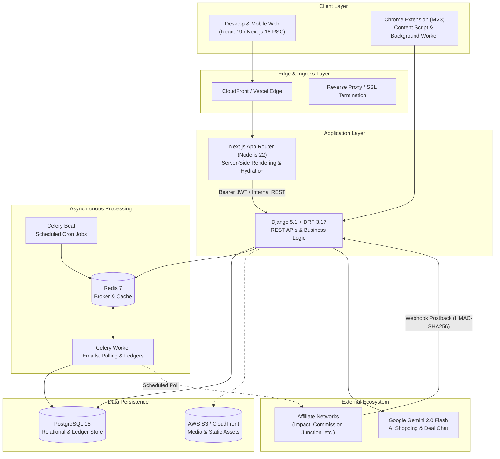
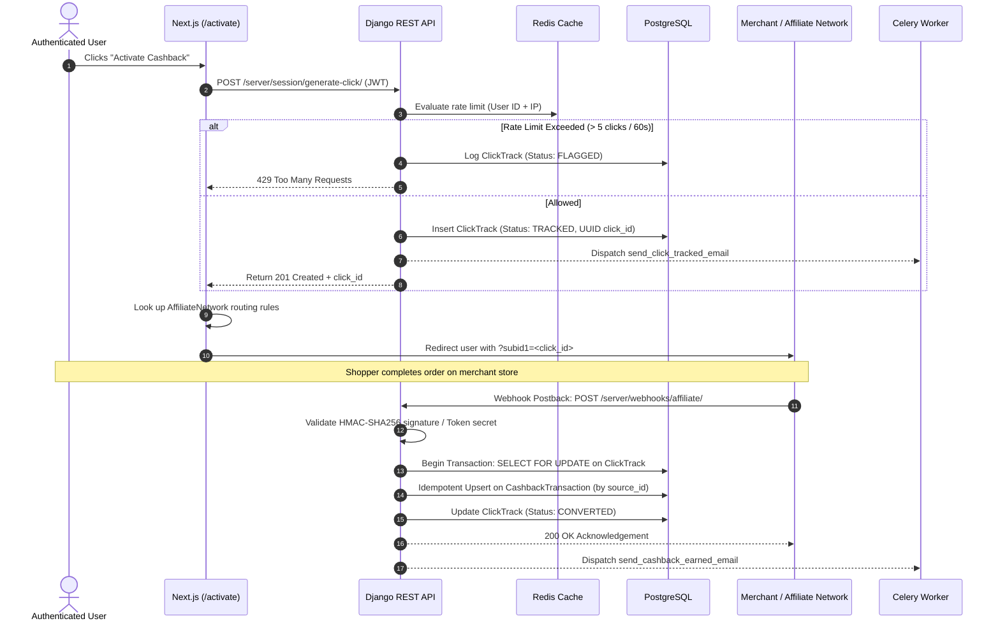

# RewardSyncHQ (DealVerse) — Executive & Technical Documentation

> **Live Product:** [rewardsynchq.com](https://rewardsynchq.com)  
> **Source Code:** [github.com/md-ajim/DealVerse](https://github.com/md-ajim/DealVerse) *(Private repository — read access available on request)*  
> **Architect & Lead Engineer:** MD Ajim (Full-Stack Engineer & System Architect)  
> **Target Audience:** Engineering Leadership (CTO, VP of Engineering, Lead Architects) & Technical Hiring Teams

---

## 1. Executive Summary (For HR & Leadership)

**RewardSyncHQ** (internally codenamed *DealVerse*) is a production-grade affiliate cashback, coupon aggregation, and AI-assisted shopping platform. The system connects digital and physical shoppers with hundreds of merchants, tracks cross-domain purchase attribution with cryptographic integrity, and programmatically distributes affiliate commissions into user cashback wallets.

### Key Business & Technical Metrics
* **Production Status:** Deployed and actively serving traffic at [rewardsynchq.com](https://rewardsynchq.com).
* **Codebase Scale:** **54,500+ first-party lines of code** (43,799 TypeScript/TSX, 8,721 Python, 2,054 Extension JS/HTML).
* **Application Surface:** 46 Next.js routes (39 pages, 7 API routes), 60+ Django REST Framework endpoints, 29 relational models.
* **Architecture:** Decoupled Multi-Tier System (Next.js 16 App Router + Django 5.1 REST + PostgreSQL 15 + Redis 7 + Celery 5.6 + Manifest V3 Chrome Extension).
* **Infrastructure:** 6-container Docker Compose microservices stack, CloudFront/S3 asset delivery, Coolify / AWS automated deployment.

---

## 2. High-Level System Architecture

---

## 3. Core Engineering Deep Dives (For Technical Leadership)

### 3.1. Click-to-Cashback Attribution Pipeline
Attributing external e-commerce purchases to internal users without browser cookie leaks requires a resilient, multi-step handshake:

### 3.2. Concurrency & Financial Integrity (Double-Spend Prevention)
* **Pessimistic Row Locking:** Webhook postbacks from affiliate networks frequently retry or send duplicate notifications simultaneously. The webhook processor executes `select_for_update()` over the associated `ClickTrack` record inside an atomic transaction.
* **Idempotent Ledger Upserts:** Transactions are uniquely constrained by `source_id` (the external network transaction ID). Repeated postbacks modify existing transaction states (`PENDING` → `CONFIRMED` → `REJECTED`) without inflating balances.
* **Dynamic Commission Splitting:** The system calculates payouts using configurable revenue-sharing matrices—respecting global defaults (e.g., 50% user share) with granular per-brand overrides.

### 3.3. Anti-Fraud & Risk Mitigation
1. **Velocity Limiting:** Redis-backed rate limiting throttles click generation per user/IP to prevent automated scraping and bot-generated SubID floods.
2. **Category Blocklists:** Restricts high-fraud or 0%-margin merchant categories from distributing rewards.
3. **Threshold-Gated Bonuses:** Referral and signup bonuses are credited to users in a locked state, unlockable only when the user crosses a verified threshold of **$15 confirmed shopping cashback**.

### 3.4. Asynchronous Task Architecture & Scalability
Offloading heavy, non-blocking I/O to Celery workers guarantees fast API response times (< 50ms):
* **Hourly Partner Polling:** Periodic Celery Beat worker polls affiliate partner APIs (e.g., Impact API) to recover any postbacks missed during webhook timeouts.
* **Price History & Wishlist Alerts:** Automated background worker scans user-tracked products daily at 02:00, checking for price drops and notifying shoppers.
* **Quarterly Payout Batching:** Scheduled ledger reconciliation executes quarterly payout batches.

### 3.5. Dual AI Engine
* **Conversational Deal Discovery:** Integrated with Google Gemini (`gemini-2.0-flash`) and DeepSeek fallback to deliver context-aware product and coupon recommendations based on active platform data.
* **Review Sentiment Analysis:** Background inference models analyze consumer reviews on brands to generate verified trust scores.

---

## 4. Full Technology Stack Breakdown

| Layer | Technologies | Justification & Architecture Role |
|---|---|---|
| **Frontend Framework** | **Next.js 16 (App Router), React 19, TypeScript** | Server Components (RSC) for maximum SEO crawlability, fast TTFB, and zero client JS overhead on content pages. |
| **Styling & UI** | **Tailwind CSS 4, Shadcn UI, Radix Primitives** | Design-system consistency, accessible UI components, and sub-second compilation. |
| **Backend Framework** | **Python 3.12, Django 5.1, DRF 3.17** | Robust ORM, built-in security, scalable REST endpoints, and battle-tested data integrity. |
| **Session & Auth** | **NextAuth 4.24, SimpleJWT, OAuth 2.0, OTP** | Hybrid authentication supporting Google OAuth, email OTP verification, and secure 30-day JWT sessions. |
| **Relational Database** | **PostgreSQL 15** | Strict relational integrity, ACID transactions, `select_for_update` row locking for financial safety. |
| **Cache & Task Broker** | **Redis 7** | In-memory message broker for Celery and high-speed cache for click rate limiting. |
| **Distributed Workers**| **Celery 5.6 + Celery Beat** | Asynchronous email dispatch, recurring webhook reconciliation, and automated price monitoring. |
| **Browser Extension** | **Chrome Manifest V3** | Vanilla JS service worker and content script injecting real-time cashback notifications on merchant sites. |
| **DevOps & Cloud** | **Docker Compose, CloudFront, AWS S3, Coolify** | Isolated 6-container production stack, CDN asset distribution, and CI/CD-driven automated deployments. |

---

## 5. Value Proposition for Engineering Leadership & Recruiters

### Why This Project Demonstrates Senior / Lead Full-Stack Competency:
1. **Full-Lifecycle Engineering:** Built from blank canvas to production—including database modeling, security design, cloud deployment, and business logic.
2. **Financial Data Rigor:** Designed around zero-loss, race-condition-free accounting principles, handling asynchronous third-party postbacks safely.
3. **Enterprise Integration Experience:** Integrates with complex external protocols: affiliate networks (HMAC webhooks), LLMs (Gemini / DeepSeek), and OAuth providers.
4. **Transparent Engineering Culture:** Codebase includes verifiable metrics, end-to-end automated tests, and documented design boundaries.
